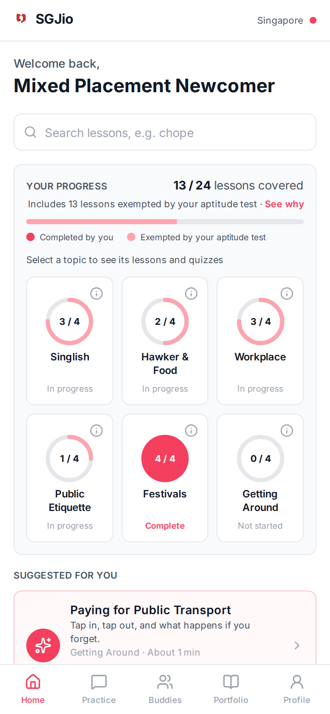
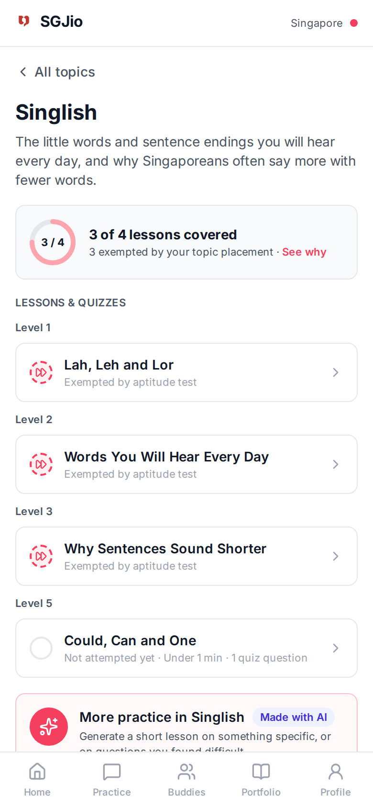
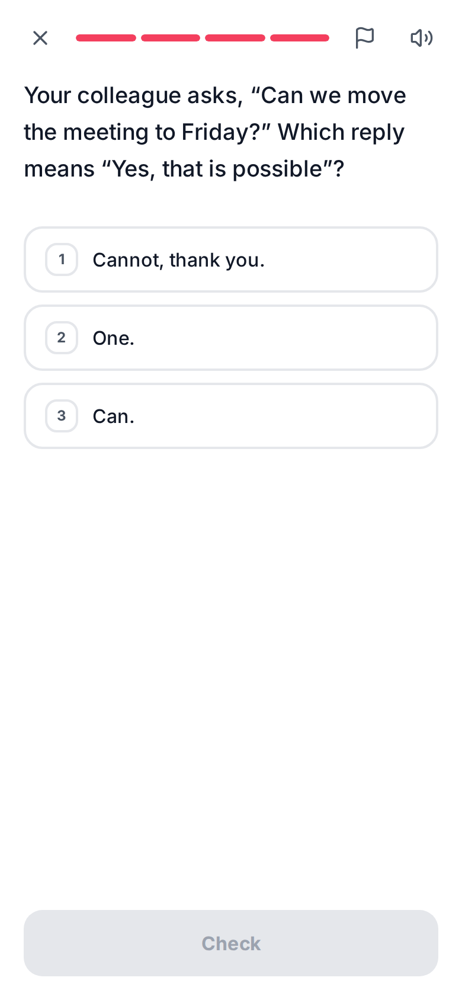
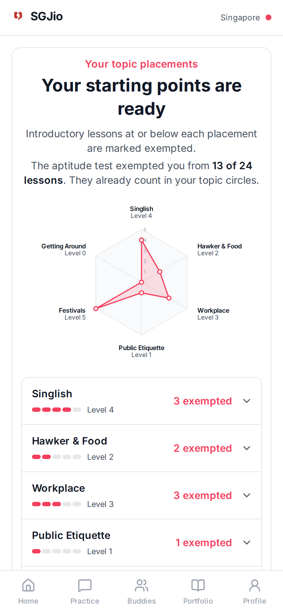
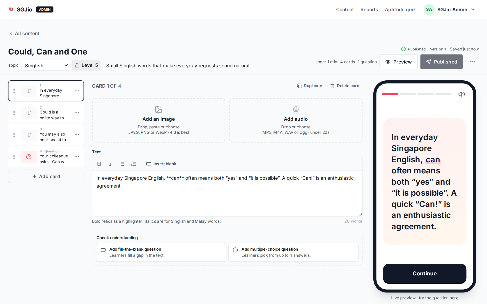
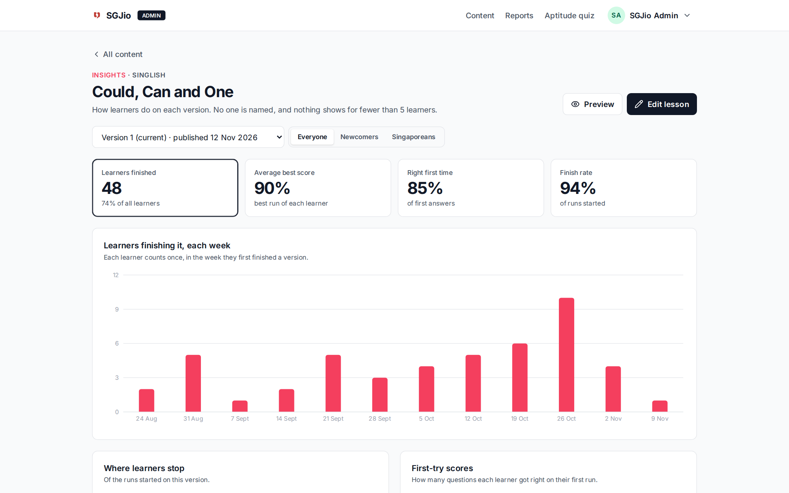

# SGJio

A web app that helps international residents learn Singapore's cultural norms (Singlish, hawker etiquette, the workplace, festivals and more) in short, card-based lessons, and build an evidenced record of their integration effort. IS4301 team project. Backlog: Jira project **SCRUM** · Design: Figma file **SGJIO**.

**Quick start** (needs Docker, Node 20.19+ and bash; details in [First-time setup](#first-time-setup)):

```bash
npm install && cp web/.env.example web/.env.local && cp .env.example .env
./dev.local --seed     # then open http://localhost:5173 and sign in as newcomer@sgjio.example.com / UserPass123
```

## What it looks like

The main app is designed phone-first and also works on desktop; the admin portal is for desktop.

| Home: progress per topic               | A topic's lessons, by level              | A lesson card with a question              | Aptitude test results                                          |
| -------------------------------------- | ---------------------------------------- | ------------------------------------------ | -------------------------------------------------------------- |
|  |  |  |  |

| Admin portal: lesson editor with live preview       | Admin portal: lesson insights                           |
| --------------------------------------------------- | ------------------------------------------------------- |
|  |  |

## What it does

**For learners** (main app, http://localhost:5173):

- Register with email or **Continue with Google**, see a short introduction, and set up a profile (all skippable).
- Take a one-off **aptitude test**: it places you at a level in each topic and exempts the lessons you already know, with a radar chart of the results.
- **Home** shows one progress circle per topic, an overall figure, search across every lesson, and a suggested next lesson from your weakest topic.
- **Lessons** are short decks of cards with text, images, audio and questions. Answers are checked on the server and each lesson keeps your best score. Learners can report a problem with a card.
- **Practice**: generate a short **AI lesson** on a topic of your choice or on your past mistakes (3 a day; never counted toward progress).
- **Profile** and **Settings**: your levels per topic, profile details, password, replaying the introduction, and deleting your account.
- **Buddies** and **Portfolio** are later modules: their tabs explain what is coming.

**For content administrators** (admin portal, http://localhost:5174):

- Manage topics and lessons: drafts, numbered published versions, withdrawing, levels, and a card editor with a live phone preview.
- **Generate draft** writes a lesson with AI for an administrator to review before publishing.
- Manage the aptitude question bank, review learners' reported problems, see anonymous **lesson insights**, and invite or remove other administrators.

**How it is built:** two React front ends call one API gateway (nginx), which routes to four Python services (Identity, Content, Learning, Notification) and an AI worker (Generation). Each service owns its own Postgres database, and they share changes as events through RabbitMQ. Why and how: [docs/architecture/](docs/architecture/README.md) (decisions in [decisions/](docs/architecture/decisions/README.md), pictures in [diagrams.md](docs/architecture/diagrams.md)).

## What is where

| Folder                   | What it is                                                                 | Runs on                       |
| ------------------------ | -------------------------------------------------------------------------- | ----------------------------- |
| `web/`                   | Main app for newcomers and Singaporeans (React)                            | http://localhost:5173         |
| `admin/`                 | Admin portal for content administrators (React)                            | http://localhost:5174         |
| `packages/ui/`           | Shared design tokens, components and sign-in helpers                       | used by `web` and `admin`     |
| `services/gateway/`      | nginx: the only way in; routes `/api/*` and checks sessions with Identity  | http://localhost:8000         |
| `services/identity/`     | Accounts, sign-in, sessions, administrators, profile, introduction         | :8001 (Swagger at `/docs`)    |
| `services/content/`      | Topics, lessons and versions, media, reported problems, aptitude questions | :8002 (Swagger at `/docs`)    |
| `services/learning/`     | Lesson runs, progress, search, review, the aptitude test, lesson insights  | :8003 (Swagger at `/docs`)    |
| `services/notification/` | Sends the emails (worker, no HTTP API)                                     | Mailpit http://localhost:8025 |
| `services/generation/`   | Writes and checks AI-generated lessons (worker, no HTTP API)               | NUS SoC LaaS, or a fake model |
| `contracts/`             | The events the services exchange, as JSON Schemas, and their validator     |                               |
| `templates/platform/`    | Plumbing every service copies (errors, logging, outbox, consumer, ...)     |                               |
| `infra/`                 | RabbitMQ definitions, Postgres init script                                 |                               |
| `e2e/`                   | End-to-end tests against the whole stack through the gateway               |                               |
| `scripts/`               | `seed-all.sh` (seed every service), `e2e.sh` (run the e2e suite)           |                               |
| `content/`               | The lessons and aptitude questions SGJio starts with, as files             | loaded by the seed            |
| `docs/`                  | Data model, product decisions, architecture                                |                               |

Each service has a README with its tables, API, events, commands and tests.

## Tech stack

- **Front end:** React 19, TypeScript, Vite, React Router, Tailwind CSS v4, lucide icons, Inter font
- **Services:** Python 3.11, FastAPI, SQLAlchemy 2, Alembic, PostgreSQL 16 (one database per service), Argon2 password hashing
- **Between services:** nginx gateway with forward auth; RabbitMQ 4.4 topic exchange; transactional outbox
- **Local:** Docker Compose runs everything except the two Vite servers (project `sgjio-ms`): 5 Postgres, RabbitMQ, Mailpit, 4 services, the generation worker, the gateway
- **AI-generated lessons:** NUS SoC LaaS (OpenAI-compatible API), or a built-in fake model
- **Quality:** Ruff, pytest, ESLint and Prettier, GitHub Actions CI (one job per service, platform template, contracts, gateway, front end, end to end)

## First-time setup

You need:

- **macOS, Linux, or WSL 2 on Windows.** The scripts are bash, so on Windows run everything inside WSL, with Docker Desktop's WSL integration turned on.
- **Docker Desktop**
- **Node 20.19+ or 22.12+** (Vite needs one of these; Node 24 works)
- **[uv](https://docs.astral.sh/uv/)**, only to run tests: a service's, the end-to-end suite or the contracts check. It fetches Python 3.11 itself; no conda or system Python needed.

```bash
npm install
cp web/.env.example web/.env.local
cp .env.example .env                 # AI lessons settings; add your key later (see below)
./dev.local --seed                   # builds and starts the stack, seeds it, then both front ends
```

AI-generated lessons work straight away with a built-in fake model. To use the real AI, follow [AI-generated lessons](#ai-generated-lessons) below.

The first build takes a few minutes. `./dev.local --seed` does, in order:

```bash
docker compose up -d --build --wait   # everything in Docker, healthy (migrations run as each service starts)
scripts/seed-all.sh                   # Identity, then Content, then Learning once the events have arrived
npm run dev:web                       # http://localhost:5173 (Vite proxies /api to the gateway on :8000)
npm run dev:admin                     # http://localhost:5174
```

Ctrl-C stops the two Vite servers; the stack keeps running in Docker. Next time, `./dev.local` without `--seed` is enough. Stop the stack with `docker compose down` (keeps your data) or `docker compose down -v` (wipes it).

When it is ready, open **http://localhost:5173** and sign in with one of the [seeded accounts](#running-it) below, or register a new one to see the introduction and the aptitude test from the start.

## Running it

| What                                                 | Where                                                                                                                           |
| ---------------------------------------------------- | ------------------------------------------------------------------------------------------------------------------------------- |
| Main app                                             | http://localhost:5173                                                                                                           |
| Admin portal                                         | http://localhost:5174                                                                                                           |
| Gateway (what the front ends call)                   | http://localhost:8000/api/...                                                                                                   |
| Swagger, per service (direct, bypassing the gateway) | Identity http://localhost:8001/docs · Content :8002/docs · Learning :8003/docs                                                  |
| RabbitMQ management (`sgjio` / `sgjio`)              | http://localhost:15672: queues `learning.events`, `content.events`, `notification.events`, `generation.events` and their `.dlq` |
| Mailpit: every email the app sends                   | http://localhost:8025                                                                                                           |
| Postgres (user = password = database name)           | identity 5433 · content 5434 · learning 5435 · notification 5436 · generation 5438                                              |

Content's and Learning's signed-in routes answer Swagger's "Try it out" with 401: they only accept requests that came through the gateway. Identity's routes and public media work there.

Seeded accounts (development only):

| Where                      | Email                        | Password       |
| -------------------------- | ---------------------------- | -------------- |
| Main app                   | `newcomer@sgjio.example.com` | `UserPass123`  |
| Main app: quiz at Level 1  | `starter@sgjio.example.com`  | `UserPass123`  |
| Main app: mixed levels     | `mixed@sgjio.example.com`    | `UserPass123`  |
| Main app: quiz at Level 4  | `advanced@sgjio.example.com` | `UserPass123`  |
| Main app: skipped the quiz | `skipped@sgjio.example.com`  | `UserPass123`  |
| Admin portal               | `admin@sgjio.example.com`    | `AdminPass123` |

To see an email arrive in Mailpit:

```bash
docker compose exec identity python -m app.cli send-reset --email admin@sgjio.example.com --scope admin
```

For lesson insights, add 60 demo learners and their lesson runs: `scripts/seed-all.sh --demo` (replaces the previous demo learners).

## Sign in with Google

The main app's sign-in and register pages have **Continue with Google** (SCRUM-92). It uses the team's Firebase project, `sgjio-966a1`: its web settings are in `web/.env.example`, and Identity's `FIREBASE_PROJECT_ID` is already set in `docker-compose.yml`, so nobody needs a Firebase account. The admin portal never offers Google.

1. Make sure `web/.env.local` exists (copied from `web/.env.example`), then restart `npm run dev:web`.
2. Open **http://localhost:5173/sign-in** and select **Continue with Google**.

| If you see                                       | Do this                                                                                                                            |
| ------------------------------------------------ | ---------------------------------------------------------------------------------------------------------------------------------- |
| No Google button                                 | `web/.env.local` is missing or empty: copy it again, then restart `npm run dev:web`                                                |
| "Google sign-in isn't set up on this server"     | Identity is running without `FIREBASE_PROJECT_ID` (`docker-compose.yml` sets it): `docker compose up -d --force-recreate identity` |
| Google's window doesn't open                     | Allow pop-ups for `localhost` in your browser                                                                                      |
| An error inside Google's window about the domain | Use `http://localhost:5173`, not `127.0.0.1` or your computer's IP: Firebase only allows `localhost`                               |
| "We couldn't confirm your Google sign-in"        | `docker compose logs identity` shows why, on a line containing `Google sign-in token refused`                                      |

**Using your own Firebase project instead** (optional): in the [Firebase console](https://console.firebase.google.com), add a project, enable **Authentication → Sign-in method → Google**, then add a web app. Put its `firebaseConfig` values in `web/.env.local`, and its project id in a `.env` file next to `docker-compose.yml` as `FIREBASE_PROJECT_ID=...`, then `docker compose up -d identity`. Leaving `web/.env.local` empty removes the Google button and nothing else changes.

## AI-generated lessons

Learners can generate short practice lessons from the **Practice** tab (and from the prompts on topic pages and on Home once every lesson is done), and administrators can generate a **draft** lesson from the **Content** page. A worker, `services/generation`, writes and checks them using **NUS SoC LaaS**, the School of Computing's free LLM service. How it works: [docs/ai-lessons-plan.md](docs/ai-lessons-plan.md). Which models and why: [docs/ai-model-evaluation.md](docs/ai-model-evaluation.md).

**Without a key, everything still works.** The worker uses a built-in fake model that returns simple sample lessons, so you can develop, test and demo the screens; CI and the end-to-end tests always use it.

### Using the real AI

1. **Get your own API key.** Each person uses their own key.
   1. Connect to the NUS network or the **NUS VPN**. The key portal only opens from inside NUS; the API itself works from anywhere.
   2. Open **https://soclaas-portal.comp.nus.edu.sg/** and sign in with your **SoC account** (forgotten password: mysoc.nus.edu.sg).
   3. Create a personal key and copy it.
2. **Put it in `.env`** next to `docker-compose.yml`. If you don't have one yet, `cp .env.example .env`. Then set:

   ```bash
   GENERATION_FAKE=false
   GENERATION_API_KEY=your-key
   ```

   `.env.example` already has the other values: the API address, `GENERATION_MODEL=qwen3.6:35b` (writes the lesson), `GENERATION_CHECK_MODEL=ornith1.5:35b` (checks learners' lessons) and `GENERATION_FALLBACK_MODEL=ornith1.5:35b` (tried if the main model fails). `.env` is git-ignored: never commit it, and never paste your key into a file that is tracked, an issue or a chat.

3. **Restart the worker** so it reads the new settings:

   ```bash
   docker compose up -d generation
   ```

4. **Try it:** in the main app, **Practice → Generate**. A lesson usually takes 10 to 20 seconds with the default model.

To check your key and see which models it can use:

```bash
curl -s -H "Authorization: Bearer $(grep ^GENERATION_API_KEY= .env | cut -d= -f2-)" \
  https://soclaas-api.comp.nus.edu.sg/v1/models | python3 -m json.tool | grep '"id"'
```

### Changing the model

Models are just settings: change them in `.env` and run `docker compose up -d generation`. No code changes.

| Setting                                      | Lessons                           | Typical wait | Notes                                                                  |
| -------------------------------------------- | --------------------------------- | ------------ | ---------------------------------------------------------------------- |
| `GENERATION_MODEL=qwen3.6:35b` (the default) | Good (3.3 out of 5 in our tests)  | 10 to 20 s   | Fast and reliable; a stable model                                      |
| `GENERATION_MODEL=x-test-2` (DeepSeek)       | Best (4.4 out of 5, none blocked) | 30 to 60 s   | A trial model on SoC LaaS: it may be withdrawn; the fallback covers it |

The evaluation behind these numbers, and how to run it again when SoC changes its models, is in [docs/ai-model-evaluation.md](docs/ai-model-evaluation.md) and `services/generation/evaluation/`.

### If something goes wrong

| If you see                                                     | Do this                                                                                                                                                                |
| -------------------------------------------------------------- | ---------------------------------------------------------------------------------------------------------------------------------------------------------------------- |
| Every lesson looks like the same simple sample                 | The fake model is on: set `GENERATION_FAKE=false` in `.env`, then `docker compose up -d generation`                                                                    |
| "We couldn't create this lesson right now"                     | `docker compose logs generation` says why: `HTTP 401` means the key is wrong; a timeout or `HTTP 5xx` means the model is busy or down (try again, or change the model) |
| The worker logs say the key or URL is not set                  | `.env` must be next to `docker-compose.yml`, with `GENERATION_API_KEY` and `GENERATION_BASE_URL` filled in                                                             |
| "You have reached today's limit"                               | Learners get 3 lessons a day and administrators 20 drafts. Failed requests don't count. To test more, register another account                                         |
| A request says "We couldn't create a lesson from that request" | The AI refused the text (off-topic, unclear, or asking for something it shouldn't). Rephrase it, or leave the box empty                                                |

## After pulling or merging

Your databases are your own (Docker volumes on your machine). Someone else's changes may need new packages, rebuilt images, new migrations or new lessons. From the repo root:

```bash
npm install
./dev.local --seed      # rebuilds changed images; each service applies its own migrations when it starts
```

The seed is safe to run again. It adds missing accounts and topics and never touches anyone's progress. Every lesson that has a file in `content/lessons` is reset to match its file and published as a new version if anything differed, so edits you made to one in the admin portal are replaced; lessons you created yourself are left alone.

**Starting over.** If your local data is in a mess, wipe this project's volumes (and nobody else's) and build it again:

```bash
docker compose down -v && ./dev.local --seed
```

## Looking inside a database

Each service has its own database; only that container has to be running.

```bash
docker compose exec identity-db psql -U identity -d identity
docker compose exec content-db psql -U content -d content
docker compose exec learning-db psql -U learning -d learning
docker compose exec notification-db psql -U notification -d notification
docker compose exec generation-db psql -U generation -d generation
```

| At the `=#` prompt      | What it does                                       |
| ----------------------- | -------------------------------------------------- |
| `\dt`                   | list the tables                                    |
| `\d lessons`            | show one table's columns                           |
| `select * from topics;` | read rows                                          |
| `\x`                    | switch to one field per line, for long lesson text |
| `\q`                    | quit                                               |

With **DBeaver** (Database → New Database Connection → PostgreSQL): host `localhost`, the port from the table above, and user, password and database all the service's name (for example `content` / `content` / `content` on 5434). Each also has a `<name>_test` database that the service's tests use.

After seeding you should find 6 users in Identity; 6 topics, 24 published lessons (each a deck of cards with illustrations and questions) plus a draft "Card gallery", and their images and audio in `media_assets` in Content; and in Learning the same topics and lessons in its read models (`learnable_topics`, `learnable_lessons`, `lesson_decks`) and some completed lessons for the Newcomer. [`docs/data-model.md`](docs/data-model.md) explains every table.

## Everyday commands

| Task                                 | Command                                                                                                  |
| ------------------------------------ | -------------------------------------------------------------------------------------------------------- |
| Start everything                     | `./dev.local` (`--seed` to seed too)                                                                     |
| Rebuild one service after a change   | `docker compose up -d --build --wait content`                                                            |
| A service's logs                     | `docker compose logs -f learning`                                                                        |
| Run a service command                | `docker compose exec content python -m app.cli <command>` (each service's README lists them)             |
| A service's tests                    | `cd services/<name> && .venv/bin/python -m pytest` (first time: see CONTRIBUTING.md)                     |
| A service's lint and format          | `cd services/<name> && .venv/bin/python -m ruff check . && .venv/bin/python -m ruff format .`            |
| New migration for a service          | `cd services/<name> && .venv/bin/python -m alembic revision --autogenerate -m "what changed"`            |
| End-to-end tests                     | `scripts/e2e.sh` (`--resilience` also stops and starts containers)                                       |
| Event contracts                      | `contracts/.venv/bin/python contracts/validate.py` (first time: see `contracts/README.md`)               |
| Gateway routing tests                | `services/gateway/tests/run.sh`                                                                          |
| Front-end lint, format, types, build | `npm run lint` · `npm run format` · `npm run typecheck` · `npm run build`                                |
| First admin, or recovery             | `docker compose exec identity python -m app.cli create-admin --email you@example.com --name "Your Name"` |
| Load lessons from files              | `docker compose exec content python -m app.cli import-lessons --publish` (see `content/README.md`)       |

Add and remove other administrators in the portal: select your name at the top right, then **Administrators**. Invite emails arrive in Mailpit.

## Troubleshooting

| Symptom                                                    | Likely cause and fix                                                                                                                                                                                                                                           |
| ---------------------------------------------------------- | -------------------------------------------------------------------------------------------------------------------------------------------------------------------------------------------------------------------------------------------------------------- |
| `port is already allocated` for 8000, 8025 or 1025         | The old monolith stack (project `sgjio`) or another app holds the port. Run `docker compose -p sgjio down` for the old stack; `docker compose ps` shows what this one is running.                                                                              |
| `docker compose up --wait` fails, a container is unhealthy | `docker compose ps` shows which; `docker compose logs <service>` says why (often a migration or a port clash).                                                                                                                                                 |
| Every page says "SGJio is unavailable right now" (503)     | A service the page needs is down. `docker compose ps`, then `docker compose up -d --wait`.                                                                                                                                                                     |
| Vite shows `ECONNREFUSED` for `/api`                       | The gateway isn't running: `docker compose up -d --wait`.                                                                                                                                                                                                      |
| A lesson you published doesn't appear for learners         | It normally takes under a second. Check `docker compose logs learning` and the `learning.events` queue (and its `.dlq`) in RabbitMQ's UI.                                                                                                                      |
| After a fresh `down -v`, learners see no topics            | Seed again (`scripts/seed-all.sh`). If seeding ran before the services were up, events sat in `sgjio.unrouted`: run `docker compose exec content python -m app.cli republish-catalog` and `docker compose exec identity python -m app.cli republish-learners`. |
| No email in Mailpit                                        | `docker compose logs notification`. It waits for the mail server and retries, so the email arrives once Mailpit is up.                                                                                                                                         |
| A reset link says it has expired                           | Links last 15 minutes and work once; a newer request cancels older links.                                                                                                                                                                                      |
| A service's tests fail to connect to Postgres              | Start its database: `docker compose up -d <name>-db` (tests use `<name>_test` on that container).                                                                                                                                                              |
| `ModuleNotFoundError` running a service's tools            | Use that service's own `.venv` (`.venv/bin/python -m ...`), made with uv as in CONTRIBUTING.md, not conda's or the system's Python.                                                                                                                            |

## How the pieces fit

- **One origin in development.** Each Vite server forwards `/api` to the gateway on :8000, which forwards each path to its service, so the browser sees a single site and cookies work without CORS.
- **Two kinds of session.** The main app and the admin portal each have their own cookie and sessions, kept by Identity. Being signed in to one never signs you in to the other (SCRUM-68 AC6).
- **Protecting a route.**
  - Identity: `Depends(require_user)` or `Depends(require_admin)` from `app/auth/deps.py`.
  - Content and Learning: `Depends(require_principal("app"))` or `("admin")` from `app/platform/principal.py`, and a matching `auth_request` location in `services/gateway/templates/gateway.conf.template`.
  - Front end: put the page inside the `<RequireAuth />` route in `App.tsx`. Signed-out visitors are sent to sign-in and brought back afterwards.
- **Changes travel as events.** When an administrator publishes a lesson, Content records an event with the change; Learning receives it and updates its own copy, usually within a second.
- **Styling.** Use the Tailwind classes generated from the Figma tokens in `packages/ui/src/theme.css`, such as `bg-brand`, `text-ink`, `border-line` and `rounded-md`. Reuse the components in `packages/ui` before writing new ones.

More detail:

- [`CONTRIBUTING.md`](CONTRIBUTING.md): branches, commits, pull requests, CI, per-service workflow
- [`docs/data-model.md`](docs/data-model.md): every service's tables and how they relate
- [`docs/decisions.md`](docs/decisions.md): values chosen for the open decisions in the stories
- [`docs/architecture/`](docs/architecture/README.md): the microservices build, its decision records and diagrams
- [`CLAUDE.md`](CLAUDE.md): project briefing read automatically by Claude Code
