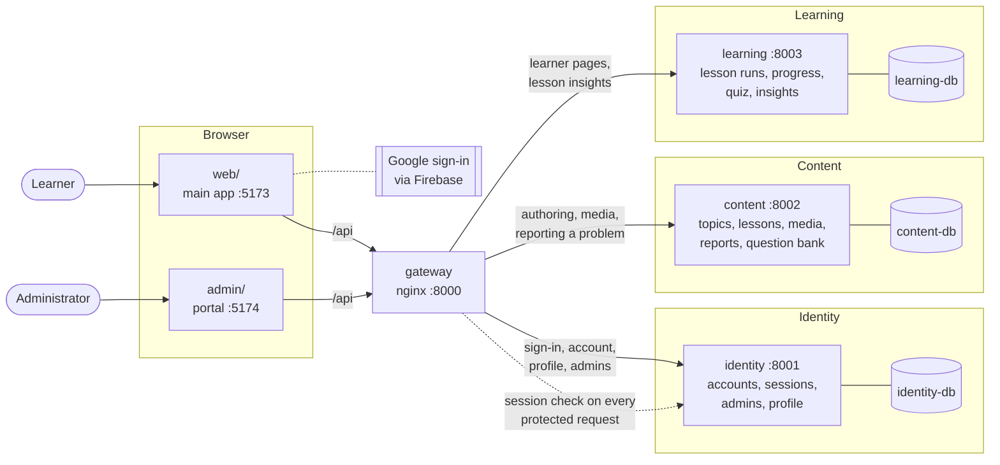
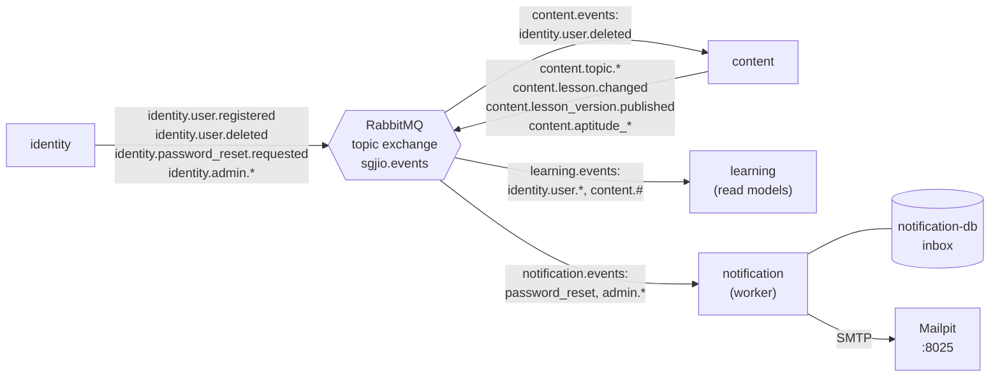
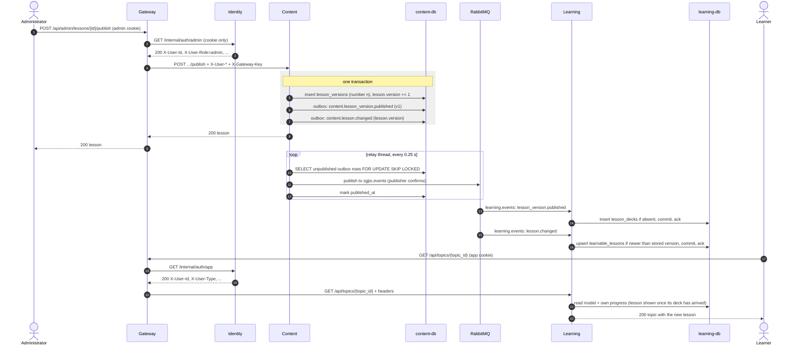
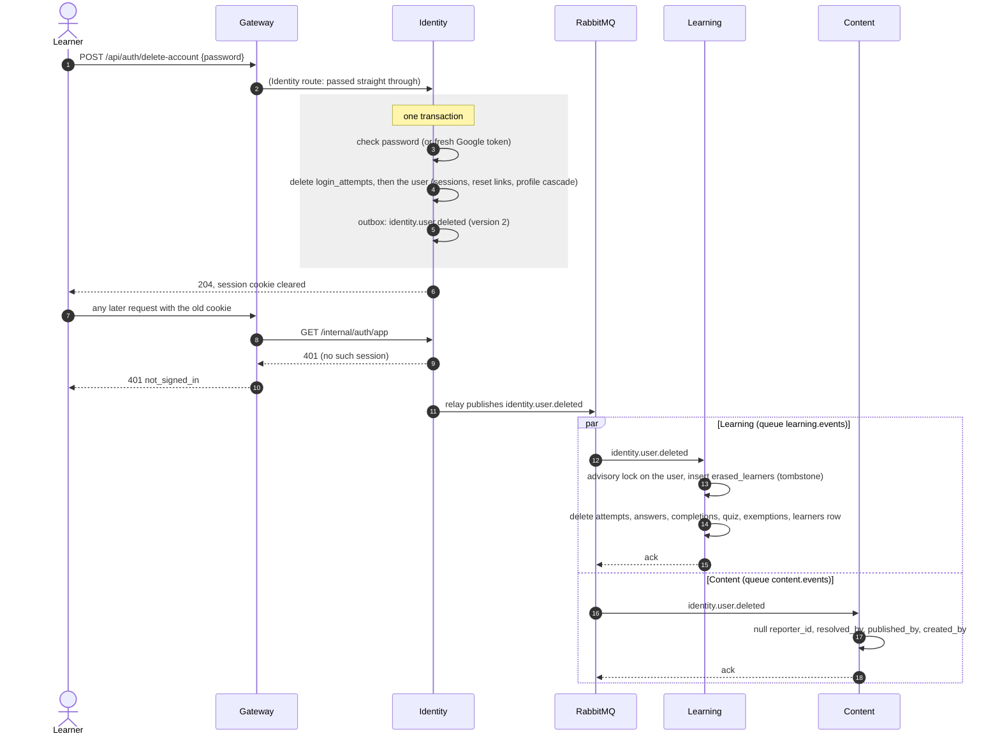
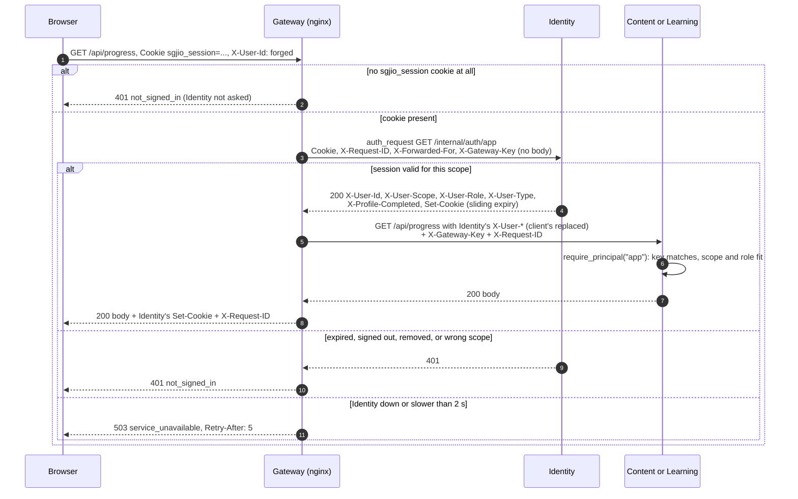

# Architecture diagrams

The microservices build as it runs in `docker-compose.yml`. GitHub renders the Mermaid blocks; the decisions behind them are in [decisions/](decisions/README.md).

## 1. System context and containers

Requests (synchronous HTTP). Every browser request goes through the gateway; the full routing table is in [services/gateway/README.md](../../services/gateway/README.md).

Events (asynchronous, through RabbitMQ). Producers write to their own `outbox` table in the same transaction as the change; a relay thread publishes it.

Only the gateway is published on all interfaces; every other port is bound to `127.0.0.1` for development. Inside Docker each service has two networks: `<name>-data`, shared only with its own database (Notification's also holds Mailpit), and `<name>-net`, shared with RabbitMQ and, for Identity, Content and Learning, the gateway. No two services share a network, so only the gateway can call them. Content and Learning refuse requests that lack the gateway's `X-Gateway-Key`; the compose default key (`dev-gateway-key`) is public, so set `GATEWAY_KEY` anywhere but a development machine. Learning and Notification publish nothing.

## 2. Publishing a lesson until a learner sees it

Steps 10 to 16 usually take well under a second. If RabbitMQ is down, steps 1 to 9 still succeed and the rows wait in the outbox; if Learning is down, the messages wait in `learning.events`.

## 3. Deleting an account

Both reactions are repeatable, so a redelivery changes nothing, and `erased_learners` makes sure a replayed `identity.user.registered` never brings the learner back ([ADR 0008](decisions/0008-account-deletion-saga.md)).

## 4. Gateway authentication (forward auth)

Identity's own routes (`/api/auth/*`, `/api/profile`, ...) skip the subrequest; the gateway drops client `X-User-*` headers there and Identity reads its cookies itself.

## 5. What still works when a component is down

From the resilience drills (`e2e/test_resilience.py`, run with `scripts/e2e.sh --resilience`), the gateway's outage checks (`services/gateway/tests/run.sh`) and the services' own tests. Every outage answer is `503 {"detail":{"code":"service_unavailable",...}}` with `Retry-After: 5`.

| Down                             | Still works                                                                                                        | Stops (503)                                                                          | After recovery                                                                                                                | Checked by                                                                                    |
| -------------------------------- | ------------------------------------------------------------------------------------------------------------------ | ------------------------------------------------------------------------------------ | ----------------------------------------------------------------------------------------------------------------------------- | --------------------------------------------------------------------------------------------- |
| **Learning**                     | sign-in, account and profile; all authoring, including publishing; media                                           | learner pages: home, topics, lessons, search, review, aptitude test; lesson insights | events published meanwhile wait in `learning.events` and are applied; the learner sees the lesson published during the outage | drill `test_learning_down_then_catches_up`                                                    |
| **learning-db**                  | everything outside Learning                                                                                        | Learning's routes (503, not 500)                                                     | Learning recovers by itself; its consumer held messages without dead-lettering them                                           | drill `test_learning_database_down_answers_503_not_500`                                       |
| **Identity**                     | public media; `/api/health`; signed-out visitors get the normal 401, so the sign-in page shows                     | every signed-in route on both front ends, including sign-in itself                   | sessions are in identity-db, so everyone is still signed in                                                                   | drill `test_identity_down_refuses_signed_in_routes_but_serves_media`; gateway `identity-down` |
| **Content**                      | learner pages, lessons and the aptitude test (served from Learning's read models); sign-in                         | authoring and the admin content pages; lesson images and audio; reporting a problem  | `identity.user.deleted` events wait in `content.events`                                                                       | gateway `content-down`                                                                        |
| **RabbitMQ**                     | every request, including publishing and forgot-password                                                            | nothing; changes stop reaching other services                                        | outboxes drain within seconds (reconnect backoff is capped at 5 s); the learner sees the lesson                               | drill `test_broker_outage_delays_but_never_loses_a_publish`                                   |
| **Mail server** (Mailpit / SMTP) | every request; forgot-password and invites still answer 204                                                        | nothing; email is delayed                                                            | Notification retries without counting failures; the email arrives                                                             | `services/notification/tests/test_delivery.py`                                                |
| **Notification**                 | every request                                                                                                      | nothing; email is delayed                                                            | messages wait in the durable `notification.events` queue and are sent                                                         | by design (queue is durable)                                                                  |
| **Gateway**                      | services directly on 127.0.0.1 ports, for Swagger only (Content and Learning refuse calls without the gateway key) | the whole app for browsers                                                           | stateless: just restart it                                                                                                    | —                                                                                             |

What does not happen in any row: a 500, a lost event, or one service's outage taking down another's routes.
