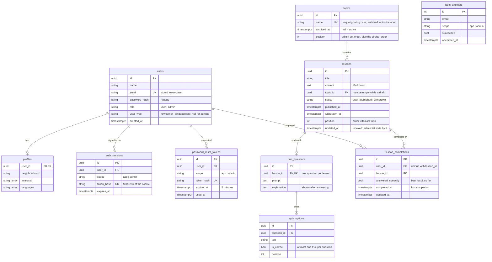

# Data model (SCRUM-72)

Defined in `api/app/models.py` and created by the migrations in `api/alembic/versions/`.

## Why it looks like this

- **One `users` table for users and administrators.** `role` separates them. Administrators are not created by registration; they are seeded or added with `python -m app.cli create-admin` (SCRUM-68 open decision).
- **Users and administrators have separate sessions.** `scope` on a session or reset link says which front end it belongs to. An admin-portal session never opens main-app routes, and the reverse holds too.
- **Tokens are stored hashed.** The raw session and reset tokens only exist in the browser cookie or the emailed link. A copy of the database cannot be used to sign in.
- **A lesson belongs to one topic.** This keeps the progress-circle arithmetic simple, as assumed in SCRUM-56. A draft may have no topic yet; publishing requires one.
- **Withdrawn lessons are kept, not deleted** (`status = withdrawn`), so users' history still shows lessons they completed (SCRUM-52 AC4).
- **Topics are archived, or deleted only when empty** (SCRUM-57). `archived_at` is a nullable timestamp: empty means active. Archiving hides the topic from users, including its progress circle and the overall figure, but keeps its lessons and everyone's completions, so restoring brings it all back. A topic with no lessons of any status can be deleted outright; otherwise the administrator must archive it. Archived topics keep reserving their name, so the unique index stays as is, and they can still be renamed. A timestamp was chosen over a flag or status column because there are only two states and the date is useful to show.
- **Topics and lessons have a `position`** (SCRUM-66). Administrators drag topics into order, and that is also the order of users' progress circles. Lessons are ordered within their topic, and lessons with no topic are ordered as one group of their own. A position is only a sort key: there is no unique constraint, and every read breaks ties by `created_at`, so a gap or a duplicate can never break a page. New topics and lessons go to the end, and so does a restored topic. Reordering always rewrites a whole topic list or a whole lesson group at once (see `docs/decisions.md`).
- **Enumerations are stored as text with a CHECK constraint**, not native Postgres enums, so adding a value later is a simple migration.
- **Completion is one row per user per lesson** (`lesson_completions`, SCRUM-16). It is written the first time the quiz is answered, right or wrong (AC3), and the unique constraint on `(user_id, lesson_id)` is what makes completion count once however many times the quiz is retaken (AC5, AC6).
- **Correctness is a column on that row, not a second table.** `answered_correctly` holds the _best_ result so far, so a later wrong answer never clears an earlier correct one (SCRUM-16 AC5). Completion feeds the progress circles; correctness feeds tiers (SCRUM-27).
- **A completion row outlives withdrawal.** Withdrawing a lesson leaves the row in place, so the user's history keeps it (SCRUM-52 AC4), while the progress query filters on `status = published` so the circle's two figures both shrink and `completed` can never exceed `available` (SCRUM-16 AC8).
- **Individual attempts are not stored.** Only the completion and the best result are. A full attempt history would be a separate table; SCRUM-42 and SCRUM-44 will say whether one is needed.

## Seed data

`python -m app.cli seed` is safe to run repeatedly. It adds:

- one administrator and one Newcomer user (see README for the sign-in details)
- the six topics from the Figma home screen: Singlish, Hawker & Food, Workplace, Public Etiquette, Festivals, Getting Around
- three published lessons per topic, eighteen in all, each with a four-option quiz question
- some completed lessons for the Newcomer account, chosen so the landing page shows every
  state a progress circle can be in: not started, in progress and complete. These are only
  added when that account has no progress at all, so re-seeding never overwrites real
  progress made by clicking through the app.
