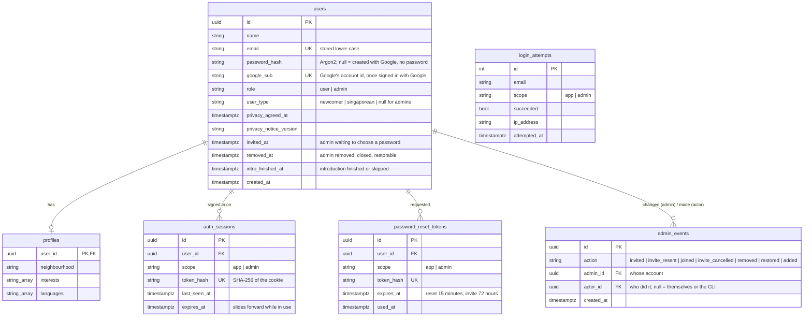
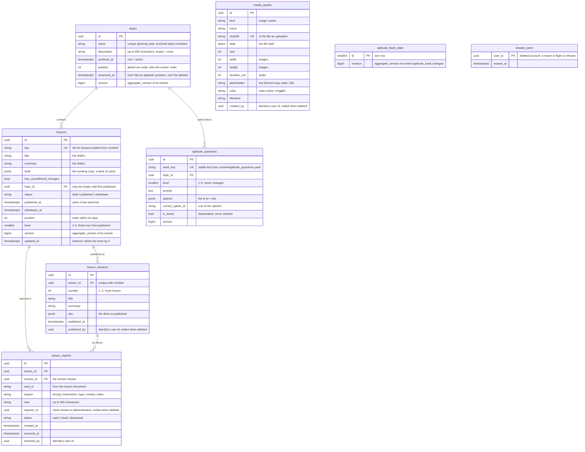
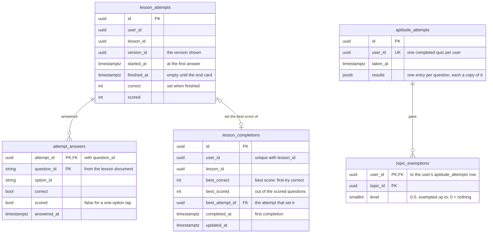
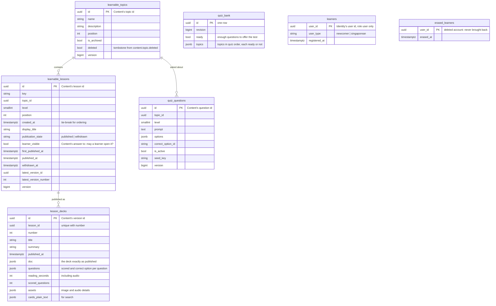

# Data model (SCRUM-72)

Each service owns its own Postgres database, defined in `services/<name>/app/models.py` and created by that service's migrations in `services/<name>/alembic/versions/`. No service reads another's tables, and there are **no foreign keys between services**: an id from another service (a user id in Content, a lesson id in Learning) is a plain UUID. What one service needs to know about another's data arrives as events (`contracts/events/`) and is kept in its own tables. The monolith's single schema, on `main`, is the starting point for all of this.

Enumerations are stored as text with a CHECK constraint (`_enum()` in each `models.py`), not native Postgres enums, so adding a value later is a simple migration. Every producer (Identity, Content) also has an `outbox` table: events waiting for the relay (`event_id`, `type`, `aggregate_type`, `aggregate_id`, `aggregate_version`, `payload`, `schema_version`, `correlation_id`, `occurred_at`, `published_at`). Identity's email events are deleted from it as soon as they are published, since their payloads hold one-time links and addresses.

## Identity (`identity-db`, port 5433)

Deleting an account cascades to its profile, sessions and reset links in this database, and sends `identity.user.deleted` so Learning and Content remove theirs (see [ADR 0008](architecture/decisions/0008-account-deletion-saga.md)).

## Content (`content-db`, port 5434)

## Learning (`learning-db`, port 5435)

Learning's own data, written by learners' requests. `user_id`, `lesson_id`, `version_id` and `topic_id` are ids from Identity and Content, with no foreign key.

### Learning's read models

Written only by Learning's event consumer (`services/learning/app/consumers.py`), never by a request. Each row keeps the `version` (or `revision`) of the event it was built from, and an event is applied only if it is newer, so duplicates and stale events change nothing ([ADR 0004](architecture/decisions/0004-idempotent-consumers-version-ordering.md), [ADR 0007](architecture/decisions/0007-read-models-in-learning.md)).

| Read model          | Event                                            | How it is applied                                                                  |
| ------------------- | ------------------------------------------------ | ---------------------------------------------------------------------------------- |
| `learnable_topics`  | `content.topic.changed`, `content.topic.deleted` | upsert if newer; delete marks `deleted` at a newer version                         |
| `learnable_lessons` | `content.lesson.changed`                         | upsert if newer                                                                    |
| `lesson_decks`      | `content.lesson_version.published`               | insert if absent (a version never changes)                                         |
| `quiz_questions`    | `content.aptitude_question.changed`              | upsert if newer                                                                    |
| `quiz_bank`         | `content.aptitude_bank.changed`                  | upsert if the revision is newer                                                    |
| `learners`          | `identity.user.registered` (role `user`)         | insert if absent, never for an id in `erased_learners`                             |
| `erased_learners`   | `identity.user.deleted`                          | insert if absent; the learner's own rows above are deleted in the same transaction |

A lesson is shown to learners only when `learner_visible` is true, its latest deck has arrived and its topic is known, not archived and not deleted (`services/learning/app/catalog.py`), so a page never lists something it cannot open while events are still arriving. To rebuild the read models: `learning reset-read-models`, then `content republish-catalog` and `identity republish-learners`.

## Notification (`notification-db`, port 5436)

| Table              | Columns                                         | What                                                                                       |
| ------------------ | ----------------------------------------------- | ------------------------------------------------------------------------------------------ |
| `processed_events` | `event_id` PK, `type`, `processed_at` (indexed) | the inbox: every event already emailed, kept 30 days, so a redelivery is not emailed twice |

## Why it looks like this

- **One `users` table for users and administrators** (Identity). `role` separates them, and one email is one account. Administrators are not created by registration; they are invited from the portal (SCRUM-81), or seeded, or added with `python -m app.cli create-admin` for the first one.
- **Signing in with Google adds a column, not a table** (SCRUM-92). `google_sub` is Google's own id for the account (not Firebase's, so links survive leaving Firebase), unique so one Google account reaches one SGJio account. An account created with Google has no `password_hash`; one that registered with a password and later used Google has both. Only one Google account per SGJio account is supported, so a separate identities table was not needed.
- **Removed administrators are kept, closed** (`removed_at`, SCRUM-81), like archived topics: they cannot sign in anywhere, and restoring them opens the account again with a new link. An invited administrator who has not yet chosen a password has `invited_at` set, and a password nobody knows.
- **`admin_events` is the history; the columns are the state.** Sign-in checks read `removed_at` and `invited_at`; the Administrators page reads the log for who added or removed someone, and for its activity list. Rows are only ever added, so every round of removing and restoring is kept.
- **Users and administrators have separate sessions.** `scope` on a session or reset link says which front end it belongs to. An admin-portal session never opens main-app routes, and the reverse holds too. The gateway asks Identity about the right one on every protected request.
- **Tokens are stored hashed.** The raw session and reset tokens only exist in the browser cookie or the emailed link. A copy of the database cannot be used to sign in.
- **A lesson belongs to one topic.** This keeps the progress-circle arithmetic simple, as assumed in SCRUM-56. A draft may have no topic yet; publishing requires one.
- **Withdrawn lessons are kept, not deleted** (`status = withdrawn`), so users' history still shows lessons they completed (SCRUM-52 AC4).
- **Topics are archived, or deleted only when empty** (SCRUM-57). `archived_at` is a nullable timestamp: empty means active. Archiving hides the topic from users, including its progress circle and the overall figure, but keeps its lessons and everyone's completions, so restoring brings it all back. A topic with no lessons of any status, that has never had an aptitude question (`assessed_at`, kept even after its questions move away), can be deleted outright; otherwise the administrator must archive it. Archived topics keep reserving their name, and they can still be renamed. A timestamp was chosen over a flag or status column because there are only two states and the date is useful to show.
- **A topic's description is plain text, and empty means none** (SCRUM-86), like a lesson's `summary`: never null, so there is only one way to have no description. Up to 200 characters, shown under the topic's name on its page.
- **Topics and lessons have a `position`** (SCRUM-66). Administrators drag topics into order, and that is also the order of users' progress circles. Lessons are ordered within their topic, and lessons with no topic are ordered as one group of their own. A position is only a sort key: there is no unique constraint, and every read breaks ties by `created_at`, so a gap or a duplicate can never break a page. New topics and lessons go to the end, and so does a restored topic. Reordering always rewrites a whole topic list or a whole lesson group at once (see `docs/decisions.md`).
- **Content's aggregates carry a `version`** (topics, lessons, aptitude questions; the bank a `revision`), bumped under the row lock in the same transaction as each change, so Learning can tell a newer event from an older one.
- **Completion is one row per user per lesson** (`lesson_completions`, SCRUM-16). It is written the first time a lesson is completed, however its answers went (AC3), and the unique constraint on `(user_id, lesson_id)` is what makes completion count once however many times it is retaken (AC5, AC6). Each run through a deck is a row in `lesson_attempts`, tied to the version shown, with the first answer to each question in `attempt_answers`; only a finished attempt completes the lesson.
- **The best score is kept on that row.** `best_correct` of `best_scored` is the best attempt so far by percentage, a tie going to the most recent, so a worse retake never lowers it (SCRUM-16 AC5). 0 of 0 (a lesson with only one-option taps) counts as full marks. Completion feeds the progress circles; the score feeds tiers (SCRUM-27).
- **A completion row outlives withdrawal.** Withdrawing a lesson leaves the row in place, so the user's history keeps it (SCRUM-52 AC4), while progress only counts lessons learners may see (`learner_visible` in Learning's read model), so the circle's two figures both shrink and `completed` can never exceed `available` (SCRUM-16 AC8).
- **A reported problem names the version and the card** (`lesson_reports`, SCRUM-82 AC3). Card ids stay the same across edits, so administrators can open the same card in today's draft (SCRUM-83 AC2). Dealing with a report marks it `fixed` or `dismissed` rather than deleting it (AC3). The reporter is kept but never shown (AC1), and is nulled if they delete their account.
- **Every attempt is stored** (`lesson_attempts`, `attempt_answers`), finished or not. Only the first answer to each question counts: the key `(attempt_id, question_id)` makes a repeated submission record nothing (SCRUM-16 AC6).
- **Levels are a number, not a table** (SCRUM-110). Lessons and aptitude questions use Level 1 to 5 (Epic 6), so each has a `level` column checked to that range. A question's level is set when it is created and never changed (SCRUM-96); a lesson's can change until it is first published, then never (SCRUM-103), so nobody's exemptions shift.
- **Exemptions are per topic, and exempted lessons are not stored** (`topic_exemptions`, SCRUM-113). Users have no level of their own. The quiz gives each topic it covers a level from 0 to 5, one row per user per topic; every published lesson in that topic at or below it is exempted (SCRUM-104). Because a published lesson's level never changes (SCRUM-103), exempted lessons are worked out from the two (`services/learning/app/exemptions.py`), so a lesson published later at an exempted level is exempted too, and nothing needs updating. `user_id` refers to the user's `aptitude_attempts` row, so exemptions only exist beside a completed quiz. Lessons are not hidden by level: everyone sees every published lesson.
- **One aptitude quiz per user** (`aptitude_attempts`, SCRUM-113 AC2). The quiz is taken once, and only a completed one is stored, together with its exemptions (SCRUM-99 AC7); `user_id` is unique. `results` holds one entry per question given, each a copy of what mattered then (question, topic, level, prompt, the option chosen and whether it was right), so editing or deactivating a question changes no one's results (SCRUM-110 AC5). Skipping the quiz (SCRUM-98) needs no field of its own: a Newcomer with no attempt has not taken it yet, and is exempted from nothing.
- **Aptitude questions are kept apart from lesson questions** (`aptitude_questions` in Content, copied to Learning's `quiz_questions`, SCRUM-96), so users don't meet them again in lessons. The database checks that the correct option is one of the options. Questions are deactivated, never deleted.
- **Lesson insights read Learning's tables and add none** (SCRUM-84, `services/learning/app/insights.py`). Each attempt names its version, so figures are per version, and each answer its option, so the page can say how often each wrong option was chosen. Learner counts and the newcomer/Singaporean split come from the `learners` read model. Nothing is stored about who saw what; the figures are worked out on each request.

## Seed data

`scripts/seed-all.sh` seeds each service in turn through the running stack, and is safe to run repeatedly. Seed users have deterministic ids (`uuid5("sgjio:user:" + email)`), so each service can find them without asking Identity.

1. **Identity** (`identity seed`): one administrator, the original Newcomer, and the aptitude personas Starter, Mixed, Advanced and Skipped (see README for the sign-in details).
2. **Content** (`content seed`): the six topics from the Figma home screen (Singlish, Hawker & Food, Workplace, Public Etiquette, Festivals, Getting Around), each with a description; the lessons in `content/lessons` (four per topic, twenty-four in all, published) plus a draft "Card gallery" showing every kind of card; and the aptitude bank in `content/aptitude_questions.yaml`, with two active questions at every level and stable keys. Running it again fills in a description only where a topic has none, and only updates lessons whose files changed (`content/README.md`).
3. **Learning** waits until the events from both have arrived (`learning wait-for-read-models`), then (`learning seed`) adds some completed lessons for the Newcomer, chosen so the landing page shows every state a circle can be in (only when that account has no progress at all), and a quiz result for each persona except Skipped.

## Demo learners

`scripts/seed-all.sh --demo [COUNT]` is separate from the seed, for the demo and for trying lesson insights (SCRUM-84). Identity's `seed-demo-learners` replaces the demo learners with 60 new ones (40 newcomers, 20 Singaporeans) at `demo.sgjio.example.com`, with a random password nobody knows, and prints a run nonce; Learning's `demo-activity --run-nonce` then adds about 1,100 runs through the published lessons over the last 12 weeks, each lesson's versions taking turns. A few questions are made confusing on purpose (`STORIES` in `services/learning/app/demo.py`). Running it again deletes the previous demo learners (Learning erases their runs through `identity.user.deleted`) and adds new ones with dates relative to today, so run it on the morning of a demo. Nobody else's data is touched.
