# Data model (SCRUM-72)

Defined in `api/app/models.py` and created by the migrations in `api/alembic/versions/`.

```mermaid
erDiagram
    users ||--o| profiles : "has"
    users ||--o{ auth_sessions : "signed in on"
    users ||--o{ password_reset_tokens : "requested"
    users ||--o{ admin_events : "changed (admin) / made (actor)"
    topics ||--o{ lessons : "contains"
    lessons ||--o{ lesson_versions : "published as"
    users ||--o{ lesson_versions : "published"
    users ||--o{ media_assets : "uploaded"
    users ||--o{ lesson_completions : "completed"
    lessons ||--o{ lesson_completions : "completed by"
    lessons ||--o{ lesson_reports : "reported in"
    lesson_versions ||--o{ lesson_reports : "as shown"

    users {
        uuid id PK
        string name
        string email UK "stored lower-case"
        string password_hash "Argon2; null = created with Google, no password"
        string google_sub UK "Google's account id, once signed in with Google"
        string role "user | admin"
        string user_type "newcomer | singaporean | null for admins"
        timestamptz invited_at "admin waiting to choose a password"
        timestamptz removed_at "admin removed: closed, restorable"
        timestamptz created_at
    }
    admin_events {
        uuid id PK
        string action "invited | invite_resent | joined | invite_cancelled | removed | restored | added"
        uuid admin_id FK "whose account"
        uuid actor_id FK "who did it; null = themselves or the CLI"
        timestamptz created_at
    }
    profiles {
        uuid user_id PK,FK
        string neighbourhood
        string_array interests
        string_array languages
    }
    topics {
        uuid id PK
        string name UK "unique ignoring case, archived topics included"
        string description "up to 200 characters, empty = none"
        timestamptz archived_at "null = active"
        int position "admin-set order, also the circles' order"
    }
    lessons {
        uuid id PK
        string key UK "set for lessons loaded from content/"
        string title "the draft's"
        string summary "the draft's"
        jsonb draft "the working copy: a deck of cards"
        bool has_unpublished_changes
        uuid topic_id FK "may be empty until first published"
        string status "draft | published | withdrawn"
        timestamptz published_at "when it last went live"
        timestamptz withdrawn_at
        int position "order within its topic"
        timestamptz updated_at "indexed: admin list sorts by it"
    }
    lesson_versions {
        uuid id PK
        uuid lesson_id FK "unique with number"
        int number "1, 2, 3 per lesson"
        string title
        string summary
        jsonb doc "the deck as published"
        timestamptz published_at
        uuid published_by FK
    }
    media_assets {
        uuid id PK
        string kind "image | audio"
        string mime
        string sha256 UK "of the file as uploaded"
        bytea data "the file itself"
        int size
        int width "images"
        int height "images"
        int duration_ms "audio"
        string placeholder "tiny blurred copy, data: URL"
        string color "main colour, #rrggbb"
        string filename
        uuid created_by FK
    }
    lesson_completions {
        uuid id PK
        uuid user_id FK "unique with lesson_id"
        uuid lesson_id FK
        int best_correct "best score: first-try correct"
        int best_scored "out of the scored questions"
        uuid best_attempt_id FK "the attempt that set it"
        timestamptz completed_at "first completion"
        timestamptz updated_at
    }
    lesson_attempts {
        uuid id PK
        uuid user_id FK
        uuid lesson_id FK
        uuid version_id FK "the version shown"
        timestamptz started_at "at the first answer"
        timestamptz finished_at "empty until the end card"
        int correct "set when finished"
        int scored
    }
    attempt_answers {
        uuid attempt_id PK "with question_id"
        string question_id PK "from the lesson document"
        string option_id
        bool correct
        bool scored "false for a one-option tap"
        timestamptz answered_at
    }
    lesson_reports {
        uuid id PK
        uuid lesson_id FK
        uuid version_id FK "the version shown"
        string card_id "from the lesson document"
        string reason "wrong | insensitive | typo | media | other"
        string note "up to 500 characters"
        uuid reporter_id FK "never shown to administrators"
        string status "open | fixed | dismissed"
        timestamptz created_at
        timestamptz resolved_at
        uuid resolved_by FK
    }
    auth_sessions {
        uuid id PK
        uuid user_id FK
        string scope "app | admin"
        string token_hash UK "SHA-256 of the cookie"
        timestamptz expires_at
    }
    password_reset_tokens {
        uuid id PK
        uuid user_id FK
        string scope "app | admin"
        string token_hash UK
        timestamptz expires_at "5 minutes"
        timestamptz used_at
    }
    login_attempts {
        int id PK
        string email
        string scope "app | admin"
        bool succeeded
        timestamptz attempted_at
    }
```

## Why it looks like this

- **One `users` table for users and administrators.** `role` separates them, and one email is one account. Administrators are not created by registration; they are invited from the portal (SCRUM-81), or seeded, or added with `python -m app.cli create-admin` for the first one.
- **Signing in with Google adds a column, not a table** (SCRUM-92). `google_sub` is Google's own id for the account (not Firebase's, so links survive leaving Firebase), unique so one Google account reaches one SGJio account. An account created with Google has no `password_hash`; one that registered with a password and later used Google has both. Only one Google account per SGJio account is supported, so a separate identities table was not needed.
- **Removed administrators are kept, closed** (`removed_at`, SCRUM-81), like archived topics: they cannot sign in anywhere, and restoring them opens the account again with a new link. An invited administrator who has not yet chosen a password has `invited_at` set, and a password nobody knows.
- **`admin_events` is the history; the columns are the state.** Sign-in checks read `removed_at` and `invited_at`; the Administrators page reads the log for who added or removed someone, and for its activity list. Rows are only ever added, so every round of removing and restoring is kept.
- **Users and administrators have separate sessions.** `scope` on a session or reset link says which front end it belongs to. An admin-portal session never opens main-app routes, and the reverse holds too.
- **Tokens are stored hashed.** The raw session and reset tokens only exist in the browser cookie or the emailed link. A copy of the database cannot be used to sign in.
- **A lesson belongs to one topic.** This keeps the progress-circle arithmetic simple, as assumed in SCRUM-56. A draft may have no topic yet; publishing requires one.
- **Withdrawn lessons are kept, not deleted** (`status = withdrawn`), so users' history still shows lessons they completed (SCRUM-52 AC4).
- **Topics are archived, or deleted only when empty** (SCRUM-57). `archived_at` is a nullable timestamp: empty means active. Archiving hides the topic from users, including its progress circle and the overall figure, but keeps its lessons and everyone's completions, so restoring brings it all back. A topic with no lessons of any status can be deleted outright; otherwise the administrator must archive it. Archived topics keep reserving their name, so the unique index stays as is, and they can still be renamed. A timestamp was chosen over a flag or status column because there are only two states and the date is useful to show.
- **A topic's description is plain text, and empty means none** (SCRUM-86), like a lesson's `summary`: never null, so there is only one way to have no description. Up to 200 characters, shown under the topic's name on its page.
- **Topics and lessons have a `position`** (SCRUM-66). Administrators drag topics into order, and that is also the order of users' progress circles. Lessons are ordered within their topic, and lessons with no topic are ordered as one group of their own. A position is only a sort key: there is no unique constraint, and every read breaks ties by `created_at`, so a gap or a duplicate can never break a page. New topics and lessons go to the end, and so does a restored topic. Reordering always rewrites a whole topic list or a whole lesson group at once (see `docs/decisions.md`).
- **Enumerations are stored as text with a CHECK constraint**, not native Postgres enums, so adding a value later is a simple migration.
- **Completion is one row per user per lesson** (`lesson_completions`, SCRUM-16). It is written the first time a lesson is completed, however its answers went (AC3), and the unique constraint on `(user_id, lesson_id)` is what makes completion count once however many times it is retaken (AC5, AC6). Each run through a deck is a row in `lesson_attempts`, tied to the version shown, with the first answer to each question in `attempt_answers`; only a finished attempt completes the lesson.
- **The best score is kept on that row.** `best_correct` of `best_scored` is the best attempt so far by percentage, a tie going to the most recent, so a worse retake never lowers it (SCRUM-16 AC5). 0 of 0 (a lesson with only one-option taps) counts as full marks. Completion feeds the progress circles; the score feeds tiers (SCRUM-27).
- **A completion row outlives withdrawal.** Withdrawing a lesson leaves the row in place, so the user's history keeps it (SCRUM-52 AC4), while the progress query filters on `status = published` so the circle's two figures both shrink and `completed` can never exceed `available` (SCRUM-16 AC8).
- **A reported problem names the version and the card** (`lesson_reports`, SCRUM-82 AC3). Card ids stay the same across edits, so administrators can open the same card in today's draft (SCRUM-83 AC2). Dealing with a report marks it `fixed` or `dismissed` rather than deleting it (AC3). The reporter is kept but never shown (AC1).
- **Every attempt is stored** (`lesson_attempts`, `attempt_answers`), finished or not, so attempt history (SCRUM-42) can read them. Only the first answer to each question counts: the key `(attempt_id, question_id)` makes a repeated submission record nothing (SCRUM-16 AC6).
- **Lesson insights read these tables and add none** (SCRUM-84, `api/app/insights.py`). Each attempt names its version, so figures are per version, and each answer its option, so the page can say how often each wrong option was chosen. Nothing is stored about who saw what; the figures are worked out on each request.

## Seed data

`python -m app.cli seed` is safe to run repeatedly. It adds:

- one administrator and one Newcomer user (see README for the sign-in details)
- the six topics from the Figma home screen: Singlish, Hawker & Food, Workplace, Public Etiquette, Festivals, Getting Around, each with a description. Running it again fills in a description only where a topic has none, so an administrator's edit is kept.
- the lessons in `content/lessons` (three per topic, eighteen in all, each a deck of cards with illustrations, some audio and two or three questions), published, plus a draft "Card gallery" showing every kind of card. Running it again only updates lessons whose files changed; see `content/README.md`.
- some completed lessons for the Newcomer account, chosen so the landing page shows every
  state a progress circle can be in: not started, in progress and complete. These are only
  added when that account has no progress at all, so re-seeding never overwrites real
  progress made by clicking through the app.

## Demo learners

`python -m app.cli demo-activity` is separate from the seed, for the demo and for trying lesson insights (SCRUM-84). It adds 60 demo learners (40 newcomers, 20 Singaporeans) at `demo.sgjio.example.com`, with a random password nobody knows, and about 1,100 runs through the published lessons over the last 12 weeks, each lesson's versions taking turns. A few questions are made confusing on purpose (`STORIES` in `api/app/demo.py`). Running it again deletes the demo learners, which deletes their runs and completions, and adds them back with dates relative to today, so run it on the morning of a demo. Nobody else's data is touched.
