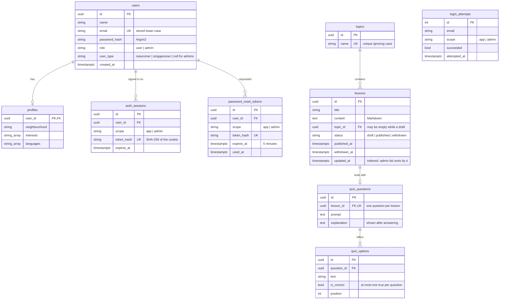

# Data model (SCRUM-72)

Defined in `api/app/models.py` and created by the migrations in `api/alembic/versions/`.

## Why it looks like this

- **One `users` table for users and administrators.** `role` separates them. Administrators are not created by registration; they are seeded or added with `python -m app.cli create-admin` (SCRUM-68 open decision).
- **Users and administrators have separate sessions.** `scope` on a session or reset link says which front end it belongs to. An admin-portal session never opens main-app routes, and the reverse holds too.
- **Tokens are stored hashed.** The raw session and reset tokens only exist in the browser cookie or the emailed link. A copy of the database cannot be used to sign in.
- **A lesson belongs to one topic.** This keeps the progress-circle arithmetic simple, as assumed in SCRUM-56. A draft may have no topic yet; publishing requires one.
- **Withdrawn lessons are kept, not deleted** (`status = withdrawn`), so users' history still shows lessons they completed (SCRUM-52 AC4).
- **Enumerations are stored as text with a CHECK constraint**, not native Postgres enums, so adding a value later is a simple migration.
- **Quiz attempts and progress are not here yet.** SCRUM-16 adds them as a new migration on top of this one.

## Seed data

`python -m app.cli seed` is safe to run repeatedly. It adds:

- one administrator and one Newcomer user (see README for the sign-in details)
- the six topics from the Figma home screen: Singlish, Hawker & Food, Workplace, Public Etiquette, Festivals, Getting Around
- one published sample lesson with a four-option quiz: "Ordering at a Local Hawker Centre"
